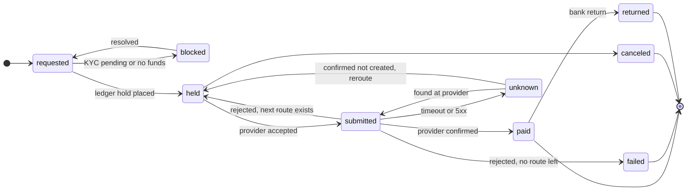

# Payout Orchestrator — Design

| | |
| --- | --- |
| **Status** | Draft v0.2 (open for review) |
| **Author** | Gabriel Roriz |
| **Updated** | 2026-11-23 |
| **See also** | [Business](00-business.md) · [Scope](01-scope.md) |

How the system meets the [scope](01-scope.md). `FR-xx` and `NFR-xx` refer to that document.

## 1. Architecture


| Service | Responsibility | Owns |
| --- | --- | --- |
| `api` | Public REST API, authentication, idempotency, event ingest | API keys, idempotency records |
| `rules-engine` | Consumes events, evaluates rules, emits earnings | Window aggregates, processed event ids |
| `ledger` | Double-entry book of record: balances and holds (gRPC) | The journal, the **source of truth** |
| `payouts` | Payout lifecycle and compliance gate | The payout state machine |
| `dispatcher` | Routing, provider adapters, circuit breakers, provider webhooks and polling | Provider attempts |
| `notifier` | Signed outbound webhooks with retries | Delivery log |

All services live in one Go module (`cmd/<service>`) and can run as a single process in development.

## 2. Kafka topics

| Topic | Key | Producer → consumers |
| --- | --- | --- |
| `perf.events.v1` | `tenant:payee` | api → rules-engine |
| `earnings.v1` | `tenant:payee` | rules-engine → ledger, notifier |
| `payouts.v1` | `payout_id` | payouts → dispatcher, notifier |
| `provider.updates.v1` | `payout_id` | dispatcher → payouts |
| `<topic>.retry` / `<topic>.dlq` | same as source | any consumer → ops tooling |

Payloads are versioned Protobuf, checked with `buf breaking` in CI.

## 3. Rules engine

Programs are data, with [CEL](https://github.com/google/cel-go) filters, so changing one needs no deploy. The running example:

```yaml
program: foodie-cashback
version: 1
effective_from: 2026-11-01T00:00:00Z
trigger:
  event: visit.completed
  filter: event.merchant.category == "restaurant"   # CEL
aggregate:
  window: calendar_month
  grace_period: 72h
  measure: count_distinct(event.merchant.id)
threshold: 10
reward:
  type: percent_of_sum
  field: event.amount
  rate: "0.05"
  rounding: half_even
  cap: { amount: 5000, currency: USD }              # minor units = $50.00
settlement: on_window_close
```

For each event, the engine skips it if its `event_id` was already processed, updates the aggregate for every matching `(rule version, payee, window)`, and emits the difference between the reward now implied and what was already accrued (decision 5).

## 4. Payout state machine



## 5. Key decisions

1. **Postgres is the bank; Kafka is the nervous system.** Balances live only in the ledger database. Kafka carries replayable facts, published through a **transactional outbox** (no dual writes).
2. **Effectively-once = at-least-once delivery + idempotency.** Each consumer records the processed message id in the same transaction as its side effect.
3. **Partition by payee.** One consumer owns a payee's aggregates and postings at a time, so there are no distributed locks (NFR-05).
4. **Money is `int64` minor units plus an ISO-4217 code.** Rule math uses decimals with explicit rounding. No floats.
5. **Earnings are deltas, not totals:** `reward(current window state) − already accrued`. Retries, late events and reversals all converge on the right number.
6. **Failover never acts on an ambiguous outcome** (FR-18). Each adapter classifies every outcome:

   ```go
   var (
       ErrRejected  = errors.New("payout rejected by provider")   // definitive: safe to reroute
       ErrRetryable = errors.New("provider temporarily failed")   // retry same provider, same key
       ErrUnknown   = errors.New("provider outcome unknown")      // resolve before anything else
   )

   type Provider interface {
       Name() string
       Supports(r Route) bool
       Submit(ctx context.Context, in Instruction) (Receipt, error)
       Status(ctx context.Context, idempotencyKey string) (Receipt, error)
   }
   ```

   The provider idempotency key is derived from `(payout, provider)`. An `unknown` payout is rerouted only after the provider confirms it holds no transfer for that key.

## 6. Capacity and durability

| Dimension | Assumption | Consequence |
| --- | --- | --- |
| Events | 20M/day, ~2.5k/s peak | Design for 5k/s; `perf.events.v1` starts at 48 partitions |
| Event buffer | ~1 KB × 7 days | ≈ 420 GB at RF 3 absorbs downstream outages |
| Ledger | ~4M journal lines/day | Tables partitioned by month |
| Payouts | ~500k in a weekly peak, ~200/s across providers | **Providers are the bottleneck**: per-provider and per-tenant token buckets in the dispatcher |

Kafka runs with RF=3, `min.insync.replicas=2`, `acks=all` and idempotent producers. Postgres has a synchronous replica and point-in-time recovery. OpenTelemetry context travels in Kafka headers, so one trace spans every hop.

## 7. Open questions

1. Which provider sandboxes can we realistically get (Wise, PayPal, Dots, Stripe Connect)?
2. Who triggers `pending → available` when a window plus its grace period closes?
3. Which ledger accounts does an earning post against, and when is the funding account debited?
