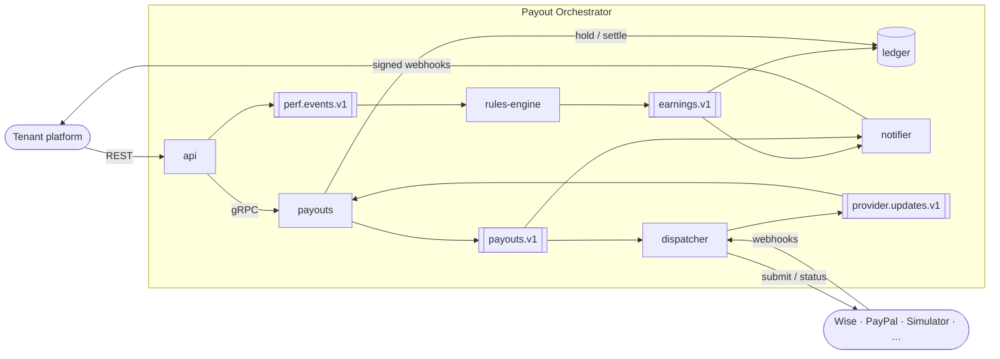
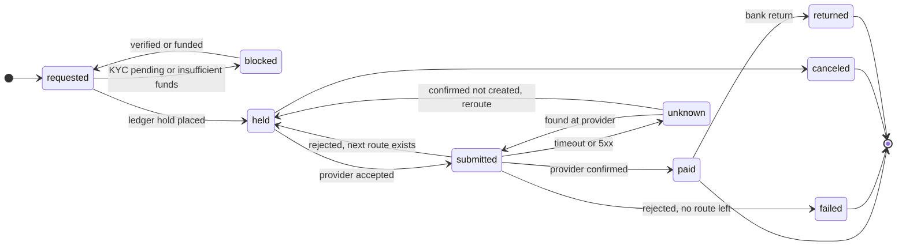

# Payout Orchestrator — Design

| | |
| --- | --- |
| **Status** | Draft v0.4 (open for review) |
| **Author** | Gabriel Roriz |
| **Updated** | 2026-11-23 |
| **See also** | [Business](00-business.md) · [Scope](01-scope.md) |

How the system meets the [scope](01-scope.md). `FR-xx` and `NFR-xx` refer to that document.

## 1. Architecture



| Service | Responsibility | Owns |
| --- | --- | --- |
| `api` | Public REST API, authentication, idempotency, event ingest | API keys, idempotency records |
| `rules-engine` | Consumes events, evaluates rules, emits earnings | Window aggregates, processed event ids |
| `ledger` | Double-entry book of record: payee and funding balances, holds (gRPC) | The journal, the **source of truth** |
| `payouts` | Payout lifecycle, compliance and funding gate, payout schedules (later) | The payout state machine |
| `dispatcher` | Routing, provider adapters, circuit breakers, provider webhooks and polling | Provider attempts |
| `notifier` | Signed outbound webhooks with retries | Delivery log |

All services live in one Go module (`cmd/<service>`) and can run as a single process in development.

## 2. Kafka topics

| Topic | Key | Producer → consumers |
| --- | --- | --- |
| `perf.events.v1` | `tenant:payee` | api → rules-engine |
| `earnings.v1` | `tenant:payee` | rules-engine → ledger, notifier |
| `payouts.v1` | `payout_id` | payouts → dispatcher, notifier |
| `provider.updates.v1` | `payout_id` | dispatcher → payouts |
| `<topic>.retry` / `<topic>.dlq` | same as source | any consumer → ops tooling |

Payloads are versioned Protobuf, checked with `buf breaking` in CI.

## 3. Rules engine

The first version supports **creator programs only**, since creator platforms are the first segment (see [business](00-business.md)). Other segments, such as cashback or affiliates, come later and reuse the same engine with new building blocks.

Programs are data, with [CEL](https://github.com/google/cel-go) filters, so changing one needs no deploy.

### Creator events

| Event | Meaning |
| --- | --- |
| `post.published` | A creator published a post (post id, platform, campaign, `published_at`) |
| `post.metrics_snapshot` | The post's **cumulative** metrics at a point in time (views, likes, …) |
| `post.removed` | The post was deleted or flagged as fraud |

The tenant tracks the metrics and sends snapshots; we never read social platforms ourselves.

### Building blocks

| Block | Options in v1 |
| --- | --- |
| Measure | Latest value of a metric per post (`max`, since snapshots are cumulative), or a count of posts |
| Window | Per post, for N days after `published_at` |
| Threshold | Minimum value before anything is paid, for example 10,000 views |
| Reward | `per_unit` (for example per 1,000 views), `fixed` per post, or tiers |
| Cap | Per post, per creator per cycle, and a total program budget (required) |
| Settlement | The cycle after which earnings become `available`, for example `weekly` |

### Example

ClipCo pays $2 per 1,000 views on TikTok and YouTube posts, for 30 days after publishing, up to $500 per post:

```yaml
program: clipco-views
version: 1
effective_from: 2026-12-01T00:00:00Z
trigger:
  event: post.metrics_snapshot
  filter: event.post.platform in ["tiktok", "youtube"]   # CEL
aggregate:
  group_by: event.post.id
  measure: max(event.metrics.views)
  window: { per: post, length: 30d }
  grace_period: 72h
reward:
  type: per_unit
  unit: 1000
  rate: { amount: 200, currency: USD }                    # minor units = $2.00
  rounding: down
cap:
  per_post: { amount: 50000, currency: USD }              # $500
  budget: { amount: 10000000, currency: USD }             # $100,000
settlement: weekly
```

### How an event is processed

1. Skip it if its `event_id` was already processed.
2. Skip it if it falls outside the post's window plus the grace period.
3. Update the post's aggregate. Because the measure is `max`, a snapshot that arrives out of order and is lower than one already seen changes nothing.
4. Emit the difference between the reward now implied and what was already accrued for that post (decision 5).

For example, snapshots of 12k, then 9k (late), then 30k views produce earnings of +$24, nothing, then +$36. A later snapshot of 400k views would add only $440, because the post hits its $500 cap. A `post.removed` inside the window drops the post's reward to zero, which emits a negative earning for everything accrued so far (a clawback).

Earnings stay `pending` until their settlement cycle plus the grace period closes, then become `available`.

## 4. Payout state machine



## 5. Key decisions

1. **Postgres is the bank; Kafka is the nervous system.** Balances live only in the ledger database. Kafka carries replayable facts, published through a **transactional outbox** (no dual writes).
2. **Effectively-once = at-least-once delivery + idempotency.** Each consumer records the processed message id in the same transaction as its side effect.
3. **Partition by payee.** One consumer owns a payee's aggregates and postings at a time, so there are no distributed locks (NFR-05).
4. **Money is `int64` minor units plus an ISO-4217 code.** Rule math uses decimals with explicit rounding. No floats.
5. **Earnings are deltas, not totals:** `reward(current window state) − already accrued`. Retries, late events and reversals all converge on the right number.
6. **Failover never acts on an ambiguous outcome** (FR-18). Each adapter classifies every outcome:

   ```go
   var (
       ErrRejected  = errors.New("payout rejected by provider")   // definitive: safe to reroute
       ErrRetryable = errors.New("provider temporarily failed")   // retry same provider, same key
       ErrUnknown   = errors.New("provider outcome unknown")      // resolve before anything else
   )

   type Provider interface {
       Name() string
       Supports(r Route) bool
       Submit(ctx context.Context, in Instruction) (Receipt, error)
       Status(ctx context.Context, idempotencyKey string) (Receipt, error)
   }
   ```

   The provider idempotency key is derived from `(payout, provider)`. An `unknown` payout is rerouted only after the provider confirms it holds no transfer for that key.

7. **The funding balance is a ledger account, not custody.** A confirmed deposit credits it. Placing a payout hold reserves the amount from it, `paid` debits it, and `failed` or `canceled` releases it. Earnings never touch it. If a provider reports a lack of funds anyway, the payout goes back to `blocked`, not to the next route.

## 6. Capacity and durability

| Dimension | Assumption | Consequence |
| --- | --- | --- |
| Events | 20M/day, ~2.5k/s peak | Design for 5k/s; `perf.events.v1` starts at 48 partitions |
| Event buffer | ~1 KB × 7 days | ≈ 420 GB at RF 3 absorbs downstream outages |
| Ledger | ~4M journal lines/day | Tables partitioned by month |
| Payouts | ~500k in a weekly peak, ~200/s across providers | **Providers are the bottleneck**: per-provider and per-tenant token buckets in the dispatcher |

Kafka runs with RF=3, `min.insync.replicas=2`, `acks=all` and idempotent producers. Postgres has a synchronous replica and point-in-time recovery. OpenTelemetry context travels in Kafka headers, so one trace spans every hop.

## 7. Open questions

1. Which provider sandboxes can we realistically get (Wise, PayPal, Dots, Stripe Connect)?
2. Who triggers `pending → available` when a window plus its grace period closes?
3. Which ledger account does an earning post against before it is funded?
4. How are deposits confirmed: reported by the tenant, or confirmed by the funding partner?
